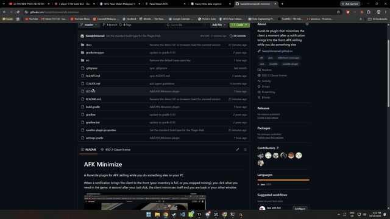

# AFK Minimize

> [!IMPORTANT]
> **AFK Minimize is not on the RuneLite Plugin Hub.** RuneLite no longer accepts plugins that minimize the client or change which window has focus. To use it, [sideload it](#install-sideload). See [why it is not on the Plugin Hub](#why-it-is-not-on-the-plugin-hub).

A RuneLite plugin for AFK skilling while you do something else on your PC.

When a notification brings the client to the front (your inventory is full, or you stopped mining), you click what you need in the game. A second after your last click, the client minimizes itself and you are back in your other window.



## Why it is not on the Plugin Hub

I submitted AFK Minimize to the RuneLite Plugin Hub in [runelite/plugin-hub#18590](https://github.com/runelite/plugin-hub/pull/18590). The RuneLite team closed the pull request with this reason:

> We are no longer accepting plugins that manipulate the client's window, including, but not limited to, minimizing or changing which window is currently focused

Minimizing the client is the main job of this plugin, so no small change makes it fit this rule. The plugin sends no input to the game and adds no menu entries. The rule is about the client window, not about the game.

## Install (sideload)

You can load AFK Minimize into your own RuneLite as a sideloaded plugin. A sideloaded plugin is a plugin jar that you put in a folder yourself. RuneLite loads it at startup, next to the Plugin Hub plugins.

1. Install a JDK, version 11 or later.
2. Clone this repo and build the plugin:

   ```
   git clone https://github.com/haziqhilmismail/afk-minimize.git
   cd afk-minimize
   gradlew jar
   ```

   On macOS or Linux, use `./gradlew jar`. The build makes `build/libs/afk-minimize.jar`.
3. Copy `afk-minimize.jar` to the `sideloaded-plugins` folder in your RuneLite folder. Create the folder if it does not exist.
   - Windows: `%USERPROFILE%\.runelite\sideloaded-plugins`
   - macOS and Linux: `~/.runelite/sideloaded-plugins`
4. Turn on developer mode. RuneLite only loads sideloaded plugins in developer mode.
   1. Open the RuneLite configure window:
      - Windows: open the Start menu and run **RuneLite (configure)**.
      - macOS: run `open -a RuneLite --args --configure` in Terminal.
   2. Add `-ea` to **JVM arguments**.
   3. Add `--developer-mode` to **Client arguments**.
   4. Click **Save**.
5. Start RuneLite as usual, also from the Jagex Launcher. **AFK Minimize** is now in the plugin list.

If you update the plugin, build the jar again and replace the old one.

To remove the plugin, delete `afk-minimize.jar` from `sideloaded-plugins`. If you have no other sideloaded plugins, also remove `-ea` and `--developer-mode`.

## Setup

1. Turn on **AFK Minimize**.
2. Turn on **Idle Notifier** and pick the alerts you want, for example **Idle animation** and **Inventory full**.
3. In the **RuneLite** settings, open **Notification Settings** and set **Request focus** to **Force**. This setting brings the client to the front when an alert fires.

## How it works

1. An alert fires while you are in another window, and the client comes to the front.
2. Each click in the game starts a countdown. A large timer at the top of the screen shows the time that is left. The timer goes from green to red.
3. If you click again before the timer gets to 0, the countdown starts again.
4. When the timer gets to 0, the client minimizes.

The plugin only arms when an alert fires while you are in another window. If you are already playing, your clicks never minimize the client.

## Keep the client open

To stop the countdown, click the timer box at the top of the screen. The click does not go to the game, so your character does not walk.

You can also set a **Keep open key** in the settings. Hold that key while you click to stop the countdown. It has no default, because Alt, Ctrl, and Shift already do things in RuneLite and the game.

The plugin stays armed, so your next normal click starts the countdown again.

## Settings

| Setting | Default | What it does |
| --- | --- | --- |
| Keep open key | Not set | Hold this key while you click to stop the countdown |
| Minimize delay | 1000 ms | Time from your last click until the client minimizes |

To move the timer, hold **Alt** and drag it.
